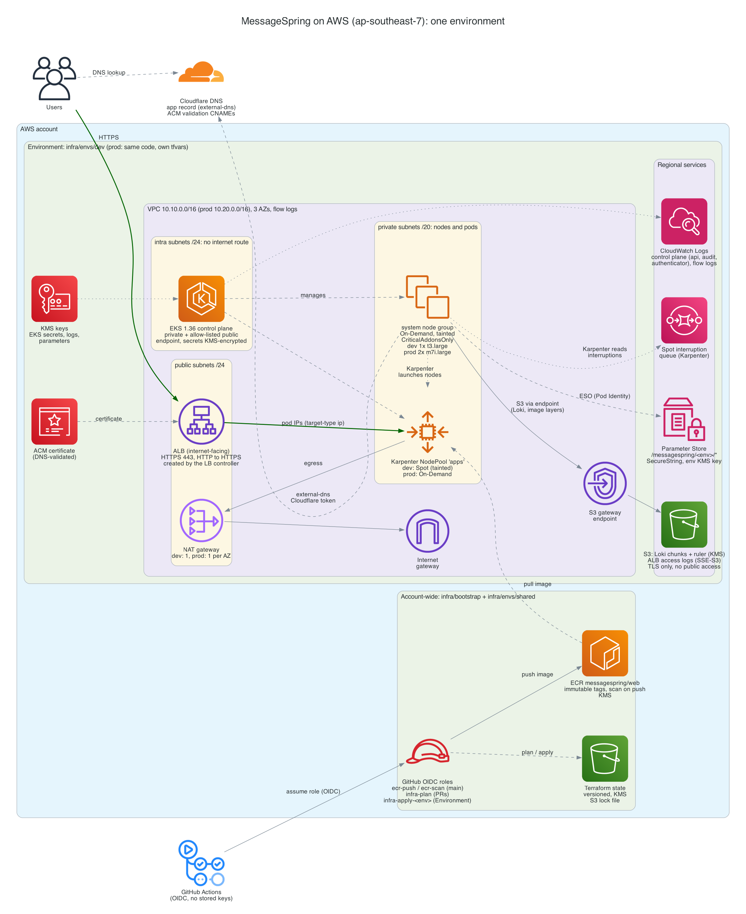
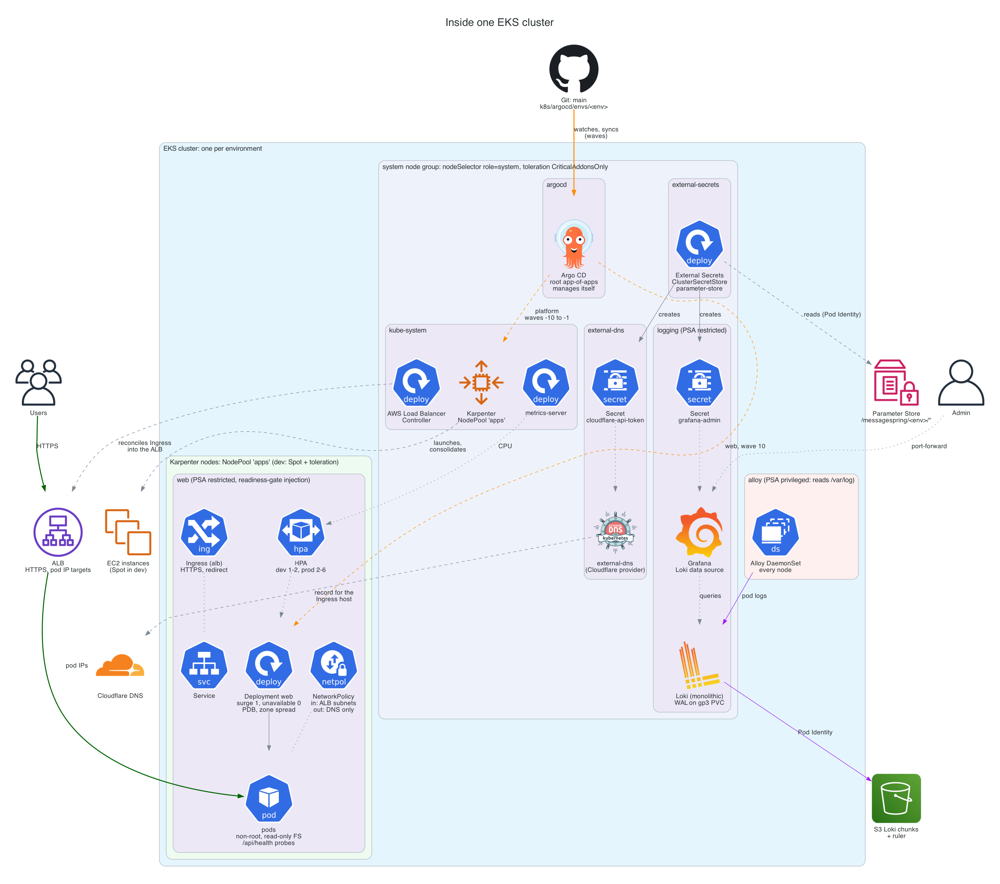

# Architecture

This document explains what the repository builds and why: the AWS
infrastructure, the container and Kubernetes setup, the CI/CD and GitOps
flow, and the decisions behind them. The diagrams are generated from code in
[`architecture/`](architecture/) and match what the code creates.

| Diagram | Shows |
| --- | --- |
| [Infrastructure](#2-infrastructure-on-aws) | AWS resources for one environment and how they connect |
| [Kubernetes](#4-kubernetes) | Namespaces, node pools, the service's objects and how traffic reaches it |
| [File structure](#9-repository-structure) | How the repository is organised, and why |
| [CI/CD](#6-cicd) and [GitOps](#5-gitops-with-argo-cd) | How a change reaches dev and prod |

Contents:

1. [Overview](#1-overview)
2. [Infrastructure on AWS](#2-infrastructure-on-aws)
3. [Application and container](#3-application-and-container)
4. [Kubernetes](#4-kubernetes)
5. [GitOps with Argo CD](#5-gitops-with-argo-cd)
6. [CI/CD](#6-cicd)
7. [Security](#7-security)
8. [Environments](#8-environments)
9. [Repository structure](#9-repository-structure)
10. [Reliability and scaling](#10-reliability-and-scaling)
11. [Cost](#11-cost)
12. [Backup and restore](#12-backup-and-restore)
13. [Decisions](#13-decisions)
14. [Next steps](#14-next-steps)

## 1. Overview

A Next.js service (a "Hello World" page plus a BFF health API) runs on Amazon
EKS in `ap-southeast-7` (Bangkok). Its image lives in a private ECR repository,
and its logs go to S3 through Loki.

- **Request path:** user → Cloudflare DNS → internet-facing ALB (TLS with an
  ACM certificate) → pod IPs in private subnets.
- **Change path:** pull request → checks → merge → CI builds, scans and pushes
  the image, then commits the new tag to Git → Argo CD syncs the cluster.
  Production changes only through a pull request.

The principles behind the design:

- **Git is the only way into the cluster.** CI has no cluster credentials and
  never runs `kubectl`; Argo CD applies what is in `k8s/`. Rollback is
  `git revert`.
- **No long-lived cloud credentials.** GitHub Actions authenticates to AWS with
  OIDC; pods get AWS credentials through EKS Pod Identity. The only stored
  tokens are for Cloudflare, which has no federation for GitHub
  ([§7](#7-security)).
- **One codebase, several environments.** dev and prod run the same Terraform
  and the same Helm charts; only `terraform.tfvars` and `values-<env>.yaml`
  differ.
- **Secure by default, least privilege.** Private nodes, encrypted storage,
  non-root read-only containers, one IAM role per controller, and namespaces
  limited by Pod Security Admission and NetworkPolicies.
- **Everything pinned.** Terraform providers and modules, Helm charts, base
  images (by digest), GitHub Actions (by commit SHA) and CI tools (by checksum).

## 2. Infrastructure on AWS

### 2.1 Terraform layout

Terraform is split into root modules with their own state, so a change can
only affect what that root owns:

| Root | Creates | Run by |
| --- | --- | --- |
| `infra/bootstrap` | S3 state bucket (versioned, KMS, TLS only) and its KMS key | a person, once (local state) |
| `infra/envs/shared` | ECR repository, GitHub OIDC provider and CI roles | CI after merge ([§6.4](#64-infrastructure-pipeline)) |
| `infra/envs/dev`, `infra/envs/prod` | VPC, EKS, node group, Pod Identity roles, log buckets, ACM certificate, secrets | CI after merge |
| `infra/envs/<env>/bootstrap` | Argo CD and its root Application (Helm) | a person, once per cluster |

The environment roots call our own modules in `infra/modules/`. Each module
has few inputs and enforces secure defaults, so an environment can't forget
encryption or open a public bucket. `network` and `eks-cluster` wrap the
community modules (`terraform-aws-modules/vpc` 6.7.3, `eks` 21.29.0 and
`eks-pod-identity` 2.10.0) instead of re-implementing them; `ecr`,
`github-oidc`, `log-storage` and `dns-tls` are plain resources because they
are short and security-critical, so a reviewer should see every line.

State is in S3 with native locking (`use_lockfile`), encrypted with a
customer-managed key, and versioned for 90 days of history. The bucket name is
passed at `init` time, so no account-specific value is committed. The code
works with Terraform ≥ 1.11 and OpenTofu.

### 2.2 Network

Each environment has its own VPC across three Availability Zones, with three
subnet tiers per zone:

| Tier | Size | Contains | Internet |
| --- | --- | --- | --- |
| public | /24 | ALB, NAT gateways | in and out |
| private | /20 | EKS nodes and pods | out, through NAT |
| intra | /24 | EKS control-plane network interfaces | none |

The private subnets are large because the VPC CNI gives every pod a VPC IP.
dev uses one NAT gateway to save money (an AZ outage can cut dev's egress);
prod has one per zone. An S3 gateway endpoint keeps S3 traffic from the nodes
(Loki chunks, ECR image layers) off the NAT, which is free and avoids NAT data
charges. VPC flow logs go to CloudWatch for troubleshooting and forensics.
dev uses `10.10.0.0/16` and prod `10.20.0.0/16`, so they could be peered later
without overlap.

### 2.3 EKS

- **Kubernetes 1.36** (one version behind the newest), upgraded through
  Terraform, dev first.
- **API endpoint:** private, plus a public endpoint allowed only from listed
  admin CIDRs.
- **Access:** access entries (`authentication_mode = API`). The cluster creator
  gets no admin rights; admins are the IAM Identity Center role of a permission
  set, looked up at plan time so no ARN is committed. CI has no access entry.
- **Encryption:** Kubernetes Secrets are envelope-encrypted with a
  customer-managed KMS key.
- **Control-plane logs:** `api`, `audit` and `authenticator` to CloudWatch
  (7 days in dev, 90 in prod).
- **Managed add-ons:** VPC CNI (with network policy enforcement on), CoreDNS,
  kube-proxy, Pod Identity Agent and the EBS CSI driver.

**Nodes.** Two kinds, kept apart with labels and taints:

- **System node group** (EKS managed, On-Demand, AL2023, encrypted gp3, IMDSv2
  with hop limit 1): label `role=system`, taint
  `CriticalAddonsOnly=true:NoSchedule`. Runs Argo CD, Karpenter, the
  controllers, CoreDNS, Loki and Grafana. dev: one t3.large; prod: two
  m7i.large in different zones.
- **Karpenter nodes** for the application, from the NodePool `apps`: Spot only
  in dev (tainted `spot=true:NoSchedule`, so only workloads that accept
  interruption land there), On-Demand in prod. Karpenter picks instance types
  (c, m, r families, generation 6+), consolidates under-used nodes and drains
  Spot nodes when the interruption queue warns it.

Karpenter itself runs on the system node group, so it never has to schedule
the node it runs on.

**Pod Identity.** Each controller that calls AWS has its own IAM role, bound to
exactly one namespace and service account:

| Service account | Can do |
| --- | --- |
| `kube-system/aws-load-balancer-controller` | manage ALBs, target groups and their security groups |
| `kube-system/karpenter` | launch and terminate instances, pass only its node role, read the interruption queue |
| `kube-system/ebs-csi-controller-sa` | create and attach EBS volumes |
| `external-secrets/external-secrets` | read parameters under `/messagespring/<env>/` and decrypt with that environment's key only |
| `logging/loki` | read and write the two Loki buckets |

Pod Identity was chosen over IRSA because the trust is managed by EKS instead
of per-role OIDC conditions, and roles carry no cluster-specific annotations.

### 2.4 Container registry

One ECR repository, `messagespring/web`, in the shared root: images are built
once and the same image is promoted from dev to prod. Tags are **immutable**
(a tag always means the same image, so the commit SHA identifies what is
running), scan on push is on, images are encrypted with KMS, and a lifecycle
policy keeps the newest 50 images, which is the rollback window.

### 2.5 Logs and object storage

- **Application and platform logs:** Grafana Alloy (DaemonSet) → Loki → S3
  ([§4.6](#46-logging)). Two buckets per environment, chunks and ruler,
  encrypted with KMS. Retention is set in Loki (7 days dev, 30 prod) and the
  chunk bucket's lifecycle rule expires objects a week later as a safety net.
- **ALB access logs:** a separate bucket with SSE-S3 (the ALB log delivery
  service doesn't support KMS keys), 30 days dev, 90 prod.
- **AWS logs:** EKS control-plane and VPC flow logs in CloudWatch.

All buckets block public access, deny non-TLS requests and are tagged.

### 2.6 DNS and TLS

The domain is in Cloudflare. Terraform requests an ACM certificate and writes
its DNS validation records to Cloudflare (a second provider). In the cluster,
external-dns creates the app's record in Cloudflare from the Ingress host, and
the AWS Load Balancer Controller finds the certificate by host name. Records
are DNS-only (not proxied), so the ALB terminates TLS (TLS 1.2/1.3 policy) and
redirects HTTP to HTTPS.

### 2.7 Secrets

Secrets live in **SSM Parameter Store** as SecureString parameters under
`/messagespring/<env>/`, encrypted with a per-environment KMS key. External
Secrets Operator syncs them into Kubernetes Secrets. Two exist today:

- **Grafana admin password:** generated by Terraform with an ephemeral
  `random_password` and written with a write-only argument, so it is never in
  Terraform state or Git.
- **Cloudflare token for external-dns:** Terraform creates the parameter with a
  placeholder; a person writes the real token, so it is never in state either.

Parameter Store (Standard tier) is free, which is why it was chosen over
Secrets Manager ($0.40 per secret per month): nothing here needs rotation,
replication or cross-account access. A database password with rotation would
go in Secrets Manager.

### 2.8 Tagging

Every resource gets `Project`, `Environment`, `ManagedBy` and `TerraformRoot`
through the provider's `default_tags`. The node group's launch template gets
them explicitly, because default tags don't reach the instances and volumes an
Auto Scaling group launches; Karpenter's nodes are tagged in their
EC2NodeClass. That's enough for cost allocation per environment.

## 3. Application and container

The app (`application/`) is Next.js 16 with the App Router, built in
`standalone` mode so the runtime image only needs `server.js` and the files it
uses.

- `/` renders a large "Hello World".
- `/api/health` (the BFF) returns `{status, version, uptimeSeconds}` with
  `Cache-Control: no-store`. It is deliberately shallow: it checks that the
  process can serve requests and calls no dependencies, so an outage elsewhere
  can't make the liveness probe restart every pod.

**Dockerfile** (multi-stage):

1. `deps`: `npm ci` with a BuildKit cache mount, in its own layer so it is
   rebuilt only when the lock file changes.
2. `build`: `next build`.
3. `runtime`: distroless Node.js 24 (`nonroot`), with only the standalone
   output and static files copied in. No shell or package manager, which
   removes most of what a scanner can find and what an attacker can use.

Base images are pinned by tag and digest. The container runs as UID 65532,
listens on 3000, and carries OCI labels with the commit. The `HEALTHCHECK`
uses Node's built-in `fetch` against `/api/health`, because the image has no
`curl` or shell.

**Local run:** `docker compose up` builds and runs the same image with a
read-only root filesystem, a tmpfs for the Next.js cache, all capabilities
dropped, `no-new-privileges` and resource limits, so local behaves like the
cluster.

## 4. Kubernetes

### 4.1 Namespaces and placement

| Namespace | Runs | Pod Security | Nodes |
| --- | --- | --- | --- |
| `web` | the application | restricted | Karpenter `apps` |
| `argocd` | Argo CD | restricted | system |
| `kube-system` | Karpenter, AWS Load Balancer Controller, metrics-server, EKS add-ons | (EKS default) | system |
| `external-secrets` | External Secrets Operator | restricted | system |
| `external-dns` | external-dns | restricted | system |
| `logging` | Loki, Grafana | restricted | system |
| `alloy` | Grafana Alloy | **privileged** | every node |

Alloy is the one exception: it reads pod logs from each node's `/var/log` and
needs a hostPath mount and root for that. It has its own namespace so that
nothing else runs with that permission. Its container still drops all
capabilities and has a read-only root filesystem.

Namespaces are files in `k8s/platform/namespaces/` (with their PSA labels and,
for `web`, the label that makes the load balancer controller inject a
readiness gate), not created implicitly by Argo CD, so their security labels
are reviewed like any other change.

### 4.2 The service's objects

The service is a small Helm chart written for it, `k8s/charts/web`, with
`values-dev.yaml` and `values-prod.yaml`:

| Object | Purpose |
| --- | --- |
| Deployment | non-root, read-only root filesystem (emptyDir for the Next.js cache), all capabilities dropped, seccomp `RuntimeDefault`, no service account token; spread across zones |
| Service | ClusterIP in front of the pods |
| Ingress | `alb` class: internet-facing ALB, HTTPS, HTTP→HTTPS redirect, pod IP targets, access logs, health check on `/api/health` |
| HorizontalPodAutoscaler | CPU-based; dev 1–2 replicas, prod 2–6 |
| PodDisruptionBudget | `maxUnavailable: 1`, so node drains and consolidation never take all pods |
| NetworkPolicy | ingress only from the public subnets (where the ALB is) on the app port; egress only DNS |
| ServiceAccount | no token mounted; the app calls no Kubernetes or AWS API |

The CPU request (100m) is used for scheduling and autoscaling. There is a
memory limit (384Mi) but no CPU limit, because a CPU limit throttles Node.js
even when the node has spare CPU.

### 4.3 How traffic reaches a pod

1. The browser resolves the host in Cloudflare; the record was created by
   external-dns from the Ingress.
2. The ALB terminates TLS with the ACM certificate found by host name, and
   redirects plain HTTP.
3. The AWS Load Balancer Controller registered the **pod IPs** directly as
   targets (`target-type: ip`), so traffic skips kube-proxy and NodePorts.
4. The pod's NetworkPolicy admits traffic from the public subnets only.

### 4.4 Health checks

The same endpoint, `/api/health`, drives every check:

| Check | Purpose | Setting |
| --- | --- | --- |
| startup probe | give the process time to start before the other probes count | every 2s, up to 60s |
| readiness probe | take a pod out of the Service while it can't serve | every 5s, 3 failures |
| liveness probe | restart a pod that is stuck | every 10s, 3 failures |
| ALB health check | route only to healthy targets | every 10s, 2 to change state |
| Argo CD health | the Application is Healthy only when the Deployment is available | built in |

The readiness gate links these: a new pod is Ready only when its readiness
probe passes **and** the ALB reports it healthy. So Kubernetes doesn't continue
a rollout until the load balancer can actually send traffic to the new pod,
and Argo CD reports `Healthy` only after that.

### 4.5 Deployment strategy

A tuned **rolling update**:

- `maxSurge: 1`, `maxUnavailable: 0`: a serving pod is removed only after its
  replacement is Ready (including the ALB readiness gate). Karpenter adds a
  node if the extra pod doesn't fit.
- `minReadySeconds: 10` and `progressDeadlineSeconds: 300`: a pod has to stay
  Ready for a while before it counts, and a stuck rollout is reported as failed
  (Argo CD shows it Degraded).
- **Graceful shutdown:** a `preStop` sleep of 15 seconds keeps a terminating
  pod serving while the ALB deregisters it (deregistration delay 30 seconds,
  termination grace period 30 seconds), so in-flight requests finish and no
  new ones arrive at a stopping pod.
- PodDisruptionBudget and zone spread keep the service up during node drains.

Why rolling and not blue-green or canary: one stateless service with a shallow
health check, where a bad version is caught by the readiness gate before it
takes traffic. Blue-green would double capacity for every release; a canary
needs traffic splitting and metrics to judge it, which this setup doesn't have
yet. The next step is Argo Rollouts with an ALB weighted canary once there are
metrics to analyse ([§14](#14-next-steps)).

### 4.6 Logging

- **Grafana Alloy** (DaemonSet on every node) tails container logs, adds
  `namespace`, `app`, `pod`, `container` and `cluster` labels, and pushes to
  Loki. It only reads pods on its own node.
- **Loki** runs in monolithic mode (one replica) with S3 for chunks, a gp3
  volume for its write-ahead log, and the compactor applying retention. It
  reaches S3 through Pod Identity. This is the smallest mode that keeps logs
  in object storage; the next sizes up are simple-scalable and distributed.
- **Grafana** has Loki provisioned as a data source, a "Logs overview"
  dashboard (log volume and error-like lines per namespace, and a log panel)
  provisioned from Git, and its admin password from the External Secret. It
  has no Ingress; admins reach it with `kubectl port-forward`.

### 4.7 Platform add-ons

| Component | Why it's there | Chart |
| --- | --- | --- |
| Argo CD | GitOps; manages itself after the bootstrap | argo-cd 10.11.6 |
| Karpenter | application nodes, Spot handling, consolidation | karpenter 1.15.1 |
| AWS Load Balancer Controller | Ingress → ALB, pod IP targets, readiness gates | 3.6.2 |
| metrics-server | CPU metrics for the HPA | 3.14.0 |
| External Secrets Operator | Parameter Store → Kubernetes Secrets | 2.14.0 |
| external-dns | DNS records in Cloudflare from the Ingress | 1.23.0 |
| gp3 StorageClass | default storage class (encrypted gp3) | manifest |
| Loki, Alloy, Grafana | logs to S3 and a UI to search them | 20.0.3, 1.14.4, 14.2.0 |

Each comes from its official chart at a pinned version, with our values in
`k8s/platform/<component>/`.

## 5. GitOps with Argo CD

**Installation as code.** `infra/envs/<env>/bootstrap` is a small Terraform
root that installs Argo CD and one root Application with the Helm provider,
using a short-lived token from `aws eks get-token` (never stored in state). A
person runs it once per cluster. After that, Argo CD manages its own
installation from `k8s/argocd/envs/<env>/argocd.yaml`, with the same values
file, so the handover changes nothing. The bootstrap ignores later changes, so
Terraform and Argo CD never fight over the release.

**App-of-apps.** The root Application points at `k8s/argocd/envs/<env>/`,
which contains one Application per component. Adding a component is adding a
file there.

**Sync waves.** Each Application has a wave, so dependencies come up in order:
projects and namespaces, then Argo CD and storage, Karpenter and its NodePool,
the controllers, External Secrets (which later waves need), logging, and
finally the application. Argo CD has no health check for Application objects
by default, so a wave wouldn't wait for the previous wave to be Healthy; a
health check in Argo CD's configuration restores that.

**AppProjects** limit what each Application may do:

| Project | Applications | Allowed |
| --- | --- | --- |
| `root` | root, argocd-projects | Application and AppProject objects in `argocd`, from this repository only |
| `platform` | the add-ons | cluster-wide, from this repository and the listed chart repositories |
| `apps` | web | the `web` namespace only, from this repository only, a fixed list of namespaced kinds, no cluster-scoped resources |

**Sync policy.** Every Application syncs automatically with `prune` (resources
removed from Git are deleted) and `selfHeal` (manual changes in the cluster
are reverted). `web` uses `PruneLast`, so old resources are removed only after
the new ones are healthy, and a finalizer, so deleting the Application also
deletes its resources. Platform Applications have no finalizer: deleting one
by mistake must not delete a controller everything depends on. Applications
that install upstream charts use server-side apply, which handles large CRDs
and fields other controllers also manage.

**Health.** The `web` Application is Healthy when its Deployment is available,
which (through the readiness gate) means the pods pass `/api/health` and the
ALB has them as healthy targets.

**Rollback.** Revert the commit in Git. For the app, that's the release commit
that changed the image tag in `values-<env>.yaml`; Argo CD syncs the previous
image, which ECR still has. Using the Argo CD UI to roll back would be undone
by self-heal, which is intended: Git stays the truth. The
[rollback runbook](docs/runbooks/rollback.md) has the steps.

**Access.** Argo CD has no Ingress, SSO or notifications in this setup; admins
use `kubectl port-forward`. Exec from the UI is disabled.

## 6. CI/CD

### 6.1 Workflows

| Workflow | Runs on | Does |
| --- | --- | --- |
| `app.yaml` + `_docker.yaml` | pull requests; pushes to `main` that change the app | lint, typecheck, build and scan the image; on `main`: push, deploy dev, open the promote PR |
| `infra.yaml` | pull requests; pushes to `main` that change `infra/` | fmt, validate, tflint, Trivy; plan per environment on PRs; apply after merge |
| `k8s.yaml` | pull requests; pushes to `main` that change `k8s/` | render every chart and manifest, kubeconform, Trivy |
| `pre-commit.yaml` | every pull request and push | the same hooks as on laptops, plus Conventional Commits |
| `secret-scan.yaml` | every pull request and push | gitleaks over the whole history |
| `image-rescan.yaml` | daily | rescans the images dev and prod run; opens an issue per environment |

### 6.2 Application pipeline

On a push to `main` that changes `application/` (or the app workflows):

1. **Quality:** `npm ci`, ESLint, TypeScript.
2. **Build:** Docker Buildx with the GitHub Actions cache, tagged with the
   7-character commit SHA, and loaded locally (not pushed yet).
3. **Scan:** Trivy fails the job on HIGH or CRITICAL vulnerabilities that have
   a fix. Nothing unscanned reaches the registry.
4. **Push:** an OIDC role that can only push to this repository, and only from
   `main`. If the tag already exists (immutable), the push is skipped.
5. **Deploy dev:** a GitHub App commits the new repository and tag to
   `k8s/charts/web/values-dev.yaml` on `main`. Argo CD sees the commit and
   rolls it out.
6. **Promote:** the same App opens, or updates, one pull request that sets
   `values-prod.yaml` to the image dev now runs, with a link to the changes
   since the current prod release. It's assigned to whoever merged the change.

Pull requests run steps 1–3 only. Pushes to `main` that don't touch the app
don't build an image: the same code would get a new tag and a needless
rollout. That also prevents a loop, since the release commits only change
`k8s/`. A build can always be started by hand.

**Why a GitHub App:** commits pushed with the default `GITHUB_TOKEN` don't
trigger workflows, so the manifest checks wouldn't run on release commits. The
App's token lasts an hour and is limited per job, the App is the only actor
allowed to bypass the `main` ruleset (for the dev commit), and its promote
commits are signed. No personal access token is involved.

### 6.3 Promotion from dev to prod

Both environments track `main`; each has its own values file. dev follows
every release automatically. prod changes only when the promote pull request
is merged, which is the production approval and goes through the same
required checks. The image is the one dev already runs: built once, scanned
once, and identified by an immutable tag.

### 6.4 Infrastructure pipeline

- **Every change:** `terraform fmt -check`, `init` (no backend, locked
  providers) and `validate` for every root, TFLint with the AWS rules, and
  Trivy on the code and the downloaded modules. No credentials needed.
- **Pull requests:** a plan for `shared`, `dev` and `prod` with a read-only
  role that trusts only pull-request runs, posted as one comment per
  environment that each push updates. Not for forks or Dependabot, which get
  no OIDC token.
- **After merge:** plan and apply the saved plan for `shared`, then `dev`, then
  `prod`, one at a time; a failure stops the rest. Each runs in a GitHub
  Environment: only `main` may deploy, prod requires a reviewer, and each
  environment's apply role trusts only that Environment.

Applies are switched on with a repository variable, because GitHub
Environments need a public repository (or a paid plan); until then the same
roots are applied from a laptop.

The bootstrap roots are not in the pipeline: the state bucket has to exist
before any pipeline can use it, and installing Argo CD needs cluster
credentials, which CI must never have.

### 6.5 Required checks and branch rules

The `main` ruleset requires a pull request, linear history (rebase merge, so
every commit is kept and checked) and five checks: `pre-commit`,
`gitleaks (full history)`, `app ok`, `infra ok` and `k8s ok`. No force pushes
or deletion; the release App is the only bypass.

The app, infra and k8s workflows filter by path, and a required check that
never runs blocks a pull request forever. So they run on every pull request,
skip their jobs when their paths didn't change, and end with an `… ok` job
that always reports and fails only if something it depends on failed.

### 6.6 Supply chain

- Actions pinned by commit SHA; every job asks for the permissions it needs
  and nothing by default (`permissions: {}` at the top).
- CLI tools installed by one script that checks each download's SHA-256.
- Terraform provider checksums in committed lock files (`-lockfile=readonly`).
- Trivy on the image (before push), the Terraform code and the charts; ECR
  scan on push; a daily rescan of the running images, because new
  vulnerabilities are found in images that haven't changed.
- gitleaks on every commit in the history, and in the pre-commit hook.
- Dependabot weekly for actions, npm, Docker, Terraform and pre-commit, with a
  7-day cooldown (most malicious releases are caught within days).
- zizmor and actionlint check the workflows themselves.

## 7. Security

**Credentials: who authenticates how.**

| Who | To | How | Scope |
| --- | --- | --- | --- |
| CI: image build | ECR | OIDC role `ecr-push` | push to one repository, `main` only |
| CI: rescan | ECR | OIDC role `ecr-scan` | pull from one repository, `main` only |
| CI: plan | AWS | OIDC role `infra-plan` | read-only plus state, pull requests only |
| CI: apply | AWS | OIDC role `infra-apply-<env>` | administrator, only from that GitHub Environment |
| CI: plan / apply | Cloudflare | API token (secret) | read-only for plans; DNS edit only in the dev/prod Environments |
| CI: release commits | GitHub | GitHub App token | contents and pull requests on this repository, 1 hour |
| Controllers | AWS | EKS Pod Identity | one role per service account ([§2.3](#23-eks)) |
| external-dns | Cloudflare | token from Parameter Store via ESO | DNS edit on one zone |
| Admins | EKS | IAM Identity Center + access entry | cluster admin |
| CI | EKS | **none** | CI never reaches the cluster |

The OIDC trust policies match GitHub's immutable subject claim
(`repo:<owner>@<owner-id>/<repo>@<repo-id>:…`), so a deleted and re-created
repository or organisation with the same name can't assume the roles.

**Network.** Nodes and pods in private subnets; the control plane's interfaces
in subnets with no internet route; the public API endpoint limited to admin
CIDRs; the app's NetworkPolicy admits only the ALB subnets and allows only DNS
out; IMDSv2 with a hop limit of 1, so pods can't take the node's IAM
credentials.

**Workloads.** Pod Security Admission `restricted` on every namespace we
create except Alloy's (`kube-system` keeps the EKS default, since EKS add-ons
run there);
non-root, read-only containers with no capabilities; distroless image; no
service account tokens where not needed; Argo CD projects limiting what each
Application can create.

**Encryption.** KMS for Kubernetes Secrets, EBS volumes, Terraform state, ECR,
the Loki buckets and the parameters; SSE-S3 for ALB logs; TLS-only bucket
policies; TLS 1.2+ at the ALB.

**Accepted exceptions, each with its reason in the code:**

- **Alloy runs privileged** in its own namespace (it reads node logs).
- **The apply roles are administrators.** Applying creates IAM roles, so a
  narrower policy is administrator-level in practice. They're limited by who
  can run them: one GitHub Environment each, `main` only, and a reviewer for
  prod. A permissions boundary on the roles they create is the next step.
- **The plan role has `ReadOnlyAccess`,** which can read most of the account.
  Only collaborators can open pull requests that get a token (forks get none).
  A narrower custom read policy is a next step.
- **Cloudflare tokens are stored secrets**, scoped to one zone, read-only where
  possible.
- **Trivy findings accepted** in `.trivyignore.yaml`: for example no CPU limit
  (on purpose), no versioning on log buckets (logs would outlive retention),
  and Karpenter's `iam:PassRole` (scoped to its node role).

## 8. Environments

dev and prod are created from the same code:

| | dev | prod |
| --- | --- | --- |
| Terraform | `infra/envs/dev` | `infra/envs/prod` (identical files) |
| Differences | `terraform.tfvars` | `terraform.tfvars` |
| VPC | `10.10.0.0/16`, one NAT | `10.20.0.0/16`, NAT per zone |
| System nodes | 1× t3.large | 2× m7i.large |
| App nodes | Karpenter Spot | Karpenter On-Demand |
| App replicas | 1–2 | 2–6 |
| Log retention | 7 days (Loki), 7 (control plane) | 30 (Loki), 90 (control plane) |
| Protection | deletion protection off, buckets force-destroyable | deletion protection on |
| Argo CD | one replica | server and repo server ×2 with PDBs |
| Kubernetes values | `values-dev.yaml` | `values-prod.yaml` |
| Deploys | every release, automatically | by merging the promote PR |

Environment-specific variables have no defaults, so an environment can't
silently inherit dev's settings.

**One cluster per environment** rather than one cluster with a namespace per
environment, because cluster-wide changes (Kubernetes upgrades, add-ons, CRDs,
admission webhooks, controller versions) need somewhere to be tested before
prod, and separate clusters separate blast radius and admin access. It costs
roughly the price of a second control plane, NAT and system nodes. More
non-production environments (test, preview) would be namespaces in the dev
cluster.

**Environments are folders, not branches.** Both environments track `main`.
With a branch per environment, promotion becomes merging between branches,
which drift apart and mix unrelated changes; with folders, the difference
between environments is a file diff, and promotion is a reviewed change to one
file.

The next step is an **AWS account per environment** (AWS Organizations), which
separates IAM, quotas and billing completely. The code is ready for it: the
roots look up account-specific values instead of hard-coding them.

## 9. Repository structure

- **One folder per concern:** `application/` (code and image), `infra/`
  (Terraform), `k8s/` (everything Argo CD deploys), `.github/` (CI),
  `scripts/` (used by both CI and people, so they behave the same),
  `architecture/` and `docs/runbooks/`.
- **Reusable modules, thin environment roots:** a module is written once and
  reviewed once; an environment root is mostly a list of module calls and a
  tfvars file.
- **Layers by lifecycle:** the state bucket, the account-wide resources, each
  environment, and each cluster's Argo CD bootstrap have their own state,
  because they change at different speeds and need different permissions.
- **`k8s/argocd/envs/<env>/`** is what each cluster runs, one file per
  component; **`k8s/platform/<component>/`** holds our values for upstream
  charts; **`k8s/charts/`** holds the charts we wrote.
- **Account-specific values** (account ID, domain) are placeholders in the
  committed files until `scripts/set-env-values.sh` writes the real ones for a
  deployment, as it did for dev's test deployment. The admin IP in
  `terraform.tfvars` never goes into Git.

## 10. Reliability and scaling

- **Multiple zones:** subnets, the system node group (prod) and the app's pods
  (zone spread) cover several Availability Zones; prod has a NAT gateway per
  zone.
- **Scaling:** the HPA scales pods on CPU; Karpenter adds nodes for pending
  pods within about a minute and removes them when empty or under-used.
- **Disruption:** PodDisruptionBudgets for the app and for Argo CD in prod,
  Karpenter disruption budgets (one node at a time) and Spot interruption
  handling.
- **Self-healing:** probes restart or remove broken pods; Argo CD reverts
  drift; a failed rollout stops and reports.
- **Limits of this setup:** Loki is a single replica, so a restart pauses
  ingestion (Alloy retries, and Loki's write-ahead log is on a persistent
  volume) and log queries; dev's platform has one system node. Both are sized
  for the workload: the next steps are Loki's simple-scalable mode and a
  larger dev system node.

## 11. Cost

A rough monthly estimate with on-demand list prices of a typical AWS region,
before data transfer and tax. Prices in `ap-southeast-7` differ; the AWS
Pricing Calculator gives exact numbers.

| Item | dev | prod |
| --- | --- | --- |
| EKS control plane ($0.10/h) | ~$73 | ~$73 |
| NAT gateways | 1 × ~$33 | 3 × ~$33 |
| System nodes | 1× t3.large ~$61 | 2× m7i.large ~$148 |
| Application nodes | Spot, ~$20 | On-Demand, ~$150 |
| ALB | ~$20 | ~$25 |
| CloudWatch Logs, S3, EBS, KMS, Parameter Store | ~$20 | ~$40 |
| **Total** | **~$230** | **~$535** |

The shared root adds a few dollars (ECR storage, KMS keys).

Choices that keep it down: one NAT gateway in dev, Spot for dev's
application nodes, Karpenter consolidation, the S3 gateway endpoint instead of
NAT for S3 traffic, Parameter Store instead of Secrets Manager, Loki on S3
instead of CloudWatch Logs for application logs, and lifecycle rules on every
bucket and on ECR. dev can be destroyed and re-created from code.

Not added, with their cost: interface endpoints for ECR, STS and others
(~$7 per endpoint per zone per month) would remove more NAT traffic; worth it
once NAT data charges exceed that.

## 12. Backup and restore

| What | Where it lives | How it's recovered |
| --- | --- | --- |
| Everything in the cluster | Git (`k8s/`) | Argo CD re-creates it on a new cluster |
| Infrastructure | Git (`infra/`) + Terraform state | re-apply; state has 90 days of versions |
| Container images | ECR (newest 50) | rebuild from the commit if older |
| Secrets | Parameter Store | Grafana's is regenerated; the Cloudflare token is re-issued |
| Logs | S3 | kept for their retention period; telemetry, not backed up |

A lost cluster is replaced, not repaired: apply the environment root, run the
bootstrap, write the Cloudflare token, and Argo CD rebuilds everything else.
The application is stateless, so there is no application data to restore.
The [backup and restore runbook](docs/runbooks/backup-restore.md) has the
steps, including restoring an old state version.

Velero would be the next step once something stateful runs in the cluster
(persistent volumes other than Loki's write-ahead log).

## 13. Decisions

| Decision | Alternatives considered | Why |
| --- | --- | --- |
| AWS, EKS | GCP/GKE | Production experience on EKS; managed control plane |
| Terraform (OpenTofu-compatible) | Pulumi, CDK | Widely used, declarative, reviewable plans |
| Own modules wrapping community modules | raw resources only; community modules directly | Reuse maintained code but expose few inputs with secure defaults |
| Root per layer, folder per environment | workspaces; Terragrunt | Separate state and permissions per layer; the tfvars diff is the environment difference; no extra tool |
| One cluster per environment | one cluster, namespace per environment | Test cluster-wide changes before prod; separate blast radius ([§8](#8-environments)) |
| System node group + Karpenter | managed node groups only; Fargate | Platform pods on stable nodes; app capacity right-sized, Spot in dev |
| Pod Identity | IRSA | Simpler trust, no per-cluster OIDC conditions or annotations |
| Ingress + ALB controller | NGINX/Traefik; service mesh; Gateway API | AWS runs L7 (ACM, pod IP targets, readiness gates); one service has no east-west traffic for a mesh to manage; Gateway API is the next step |
| Cloudflare DNS + ACM | Route 53 | The domain already lives in Cloudflare; ACM validated through the Cloudflare provider |
| Parameter Store + External Secrets | Secrets Manager; Sealed Secrets; SOPS | Free, KMS-encrypted, IAM-scoped per environment; secrets never in Git |
| Argo CD, app-of-apps, sync waves | Flux; ApplicationSets | UI and health model; one explicit file per component and environment is easy to review |
| Own Helm chart for the app | Kustomize; raw manifests | Versioned, one chart for both environments; values files are the difference |
| Alloy → Loki (S3) → Grafana | Fluent Bit → S3; CloudWatch | Logs in object storage *and* searchable; Promtail is end-of-life |
| GitOps pull deploy | CI runs `kubectl`/`helm` | No cluster credentials in CI; drift is reverted; rollback is `git revert` |
| GitHub App for release commits | `GITHUB_TOKEN`; personal access token | Its commits trigger checks; short-lived scoped token; one bypass actor |
| dev auto, prod by pull request | both automatic; manual tags | Fast feedback in dev; a reviewed, recorded approval for prod |
| Rolling update with readiness gates | blue-green; canary | Enough for one stateless service; canary needs metrics first |
| Trunk-based, environments as folders | branch per environment | No drifting branches; promotion is a one-file diff |
| Immutable tags = commit SHA | `latest`; semantic versions | A tag always means one image; traceable to the commit |
| Rebase merge + required "ok" checks | squash; path-filtered required checks | Every commit kept and checked; required checks work with path filters |

## 14. Next steps

What I would add next, roughly in order:

1. **Metrics and alerts:** Prometheus (or Alloy) for metrics, Loki ruler
   alerts, dashboards, and OpenTelemetry traces through Alloy.
2. **Canary releases:** Argo Rollouts with ALB weighted target groups and
   automatic analysis on error rate and latency.
3. **Gateway API** instead of Ingress, once the load balancer controller's
   Gateway support covers readiness gates and certificate discovery.
4. **Account per environment** with AWS Organizations and SCPs.
5. **Narrower CI roles:** a permissions boundary for roles created by apply,
   and a custom read policy for plans.
6. **Cloudflare proxy** with Full (strict) TLS, the ALB limited to Cloudflare's
   IP ranges, and WAF rules.
7. **NetworkPolicies for the platform namespaces** (Loki, Grafana, Argo CD),
   not only the app.
8. **Renovate** for the Argo CD chart versions and the CI tool pins, which
   Dependabot doesn't cover.
9. **A CI job that re-renders the diagrams** and fails on a diff.
10. **A service mesh only if it's needed:** when several services call each
    other, need mTLS, per-route retries or traffic splitting. Istio ambient
    mode would be the choice then.
11. **Chaos tests** with AWS Fault Injection Service: terminate nodes, stop a
    zone's NAT, interrupt Spot nodes, and check that the service stays up.
