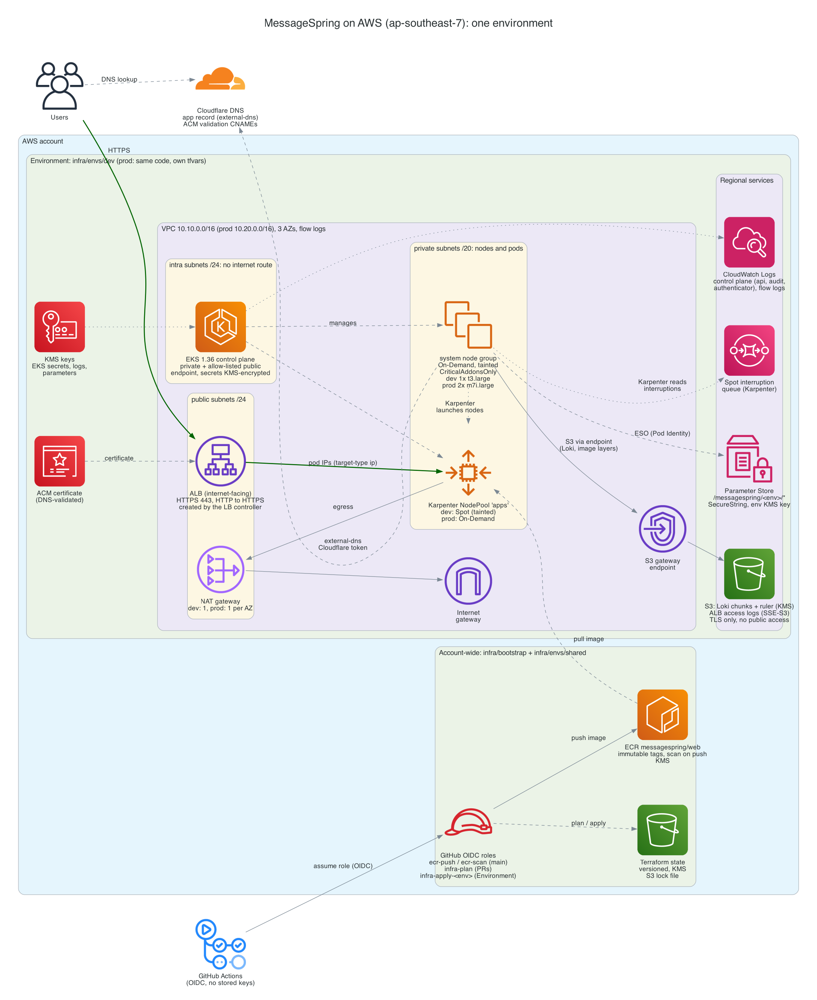

# MessageSpring DevOps challenge

Infrastructure, containers, Kubernetes manifests and CI/CD with GitOps for a
small Next.js service on AWS:

- **AWS:** Terraform for a VPC, an EKS cluster with Karpenter, a private ECR
  registry and logs in S3, with the same code for dev and prod.
- **Container:** a multi-stage, non-root, distroless image with a health
  check, and Docker Compose for local runs.
- **Kubernetes:** a Helm chart deployed by Argo CD, exposed through an ALB with
  HTTPS, with probes on the BFF health endpoint.
- **CI/CD:** GitHub Actions builds, scans and pushes the image and commits the
  new tag to Git; Argo CD deploys it. Prod changes through a pull request.
  CI never touches the cluster.

**[ARCHITECTURE.md](ARCHITECTURE.md)** explains the design and every decision.
The diagrams are in [`architecture/`](architecture/) as code with exported
images.



## Repository layout

```text
.
├── application/          Next.js app (frontend + /api/health BFF) and its Dockerfile
├── infra/
│   ├── bootstrap/        Terraform state bucket (run once)
│   ├── modules/          network, eks-cluster, log-storage, dns-tls, ecr, github-oidc, argocd-bootstrap
│   └── envs/             shared (ECR, CI roles), dev, prod; <env>/bootstrap installs Argo CD
├── k8s/
│   ├── charts/           web (the service), karpenter-nodes
│   ├── platform/         values for the add-on charts, namespaces, storage class
│   └── argocd/           AppProjects and one Application per component per environment
├── .github/              workflows, a composite action, Dependabot
├── scripts/              shared by CI and people: validation, image bump, environment values
├── architecture/         diagrams as code + exported images
├── docs/runbooks/        GitHub setup, cluster bootstrap, rollback, backup and restore
├── docker-compose.yml    local run
├── .env.example          optional local settings
├── README.md
└── ARCHITECTURE.md
```

Why it's organised this way: [ARCHITECTURE.md §9](ARCHITECTURE.md#9-repository-structure).

## Run it locally

```bash
docker compose up --build
curl http://localhost:3000/              # Hello World
curl http://localhost:3000/api/health    # {"status":"ok","version":"local","uptimeSeconds":...}
```

`cp .env.example .env` to change the host port or the reported version. Without
Docker: `cd application && npm ci && npm run dev`.

## Requirements and where they are

### Infrastructure

| Requirement | Where |
| --- | --- |
| Managed Kubernetes | EKS: [`infra/modules/eks-cluster`](infra/modules/eks-cluster), called from [`infra/envs/dev`](infra/envs/dev) and [`prod`](infra/envs/prod) |
| Private container registry | ECR, immutable tags, scan on push: [`infra/modules/ecr`](infra/modules/ecr), [`infra/envs/shared`](infra/envs/shared) |
| Logs to object storage | Alloy → Loki → S3: buckets in [`infra/modules/log-storage`](infra/modules/log-storage), Loki in [`k8s/platform/loki`](k8s/platform/loki); ALB access logs to S3 |
| Secure and reliable | private nodes, 3 AZs, KMS everywhere, least-privilege Pod Identity roles, NetworkPolicies, PSA: [ARCHITECTURE.md §2](ARCHITECTURE.md#2-infrastructure-on-aws), [§7](ARCHITECTURE.md#7-security) |
| What was built and why | [ARCHITECTURE.md](ARCHITECTURE.md) and [`architecture/`](architecture/) |

### Application, containers and Kubernetes

| Requirement | Where |
| --- | --- |
| One Next.js app, frontend + BFF | [`application/app/page.tsx`](application/app/page.tsx) (`/`), [`application/app/api/health/route.ts`](application/app/api/health/route.ts) |
| Multi-stage build, non-root, health check | [`application/Dockerfile`](application/Dockerfile): distroless runtime, UID 65532, `HEALTHCHECK` on `/api/health` |
| Pushed to the registry, tagged by commit | [`.github/workflows/_docker.yaml`](.github/workflows/_docker.yaml): tag = commit SHA |
| Docker Compose | [`docker-compose.yml`](docker-compose.yml) |
| Manifests in `k8s/`, deployed by GitOps | [`k8s/charts/web`](k8s/charts/web), Applications in [`k8s/argocd/envs`](k8s/argocd/envs) |
| Readiness and liveness on the health endpoint | [`k8s/charts/web/templates/deployment.yaml`](k8s/charts/web/templates/deployment.yaml) (plus a startup probe) |
| Exposed through an Ingress | [`k8s/charts/web/templates/ingress.yaml`](k8s/charts/web/templates/ingress.yaml): ALB, HTTPS, HTTP→HTTPS redirect |

### CI/CD with GitOps

| Requirement | Where |
| --- | --- |
| CI on every push to `main` | [`.github/workflows`](.github/workflows): pre-commit and the secret scan run on every push; the app pipeline on every push that changes the app ([why](ARCHITECTURE.md#62-application-pipeline)) |
| Lint and build the app | [`app.yaml`](.github/workflows/app.yaml): ESLint, TypeScript, `next build` in the image |
| Build, push, tag with the commit SHA | [`_docker.yaml`](.github/workflows/_docker.yaml): build → Trivy gate → push |
| Update the tag in Git to deploy | [`app.yaml`](.github/workflows/app.yaml): commit to `values-dev.yaml`, pull request for `values-prod.yaml` |
| GitOps tool installed as code | Argo CD: [`infra/modules/argocd-bootstrap`](infra/modules/argocd-bootstrap), then self-managed from [`k8s/argocd/envs/<env>/argocd.yaml`](k8s/argocd/envs/dev/argocd.yaml) |
| Watches `k8s/`, applies every change | root app-of-apps: [`k8s/argocd/envs`](k8s/argocd/envs) |
| Auto-sync with prune and self-heal | `syncPolicy.automated` on every Application, e.g. [`web.yaml`](k8s/argocd/envs/prod/web.yaml) |
| Health from the BFF endpoint | probes and the ALB health check on `/api/health`, ALB readiness gate: [ARCHITECTURE.md §4.4](ARCHITECTURE.md#44-health-checks) |
| Rollback by reverting in Git | [`docs/runbooks/rollback.md`](docs/runbooks/rollback.md) |
| Infra PRs: format, validate, plan | [`infra.yaml`](.github/workflows/infra.yaml): fmt, validate, tflint, Trivy, plan comment per environment |
| Apply only after merge or approval | [`infra.yaml`](.github/workflows/infra.yaml): apply on `main`, GitHub Environments, prod reviewer |
| No cluster credentials in CI | no EKS access entry for any CI role; the pipeline never runs `kubectl` ([§7](ARCHITECTURE.md#7-security)) |
| No secrets in the repository | OIDC to AWS, secrets in GitHub's store and Parameter Store; gitleaks in pre-commit and CI |

### Architecture design

| Requirement | Where |
| --- | --- |
| Infrastructure architecture | [`architecture/infrastructure.py`](architecture/infrastructure.py) → [`.png`](architecture/infrastructure.png) |
| Kubernetes components and traffic | [`architecture/kubernetes.py`](architecture/kubernetes.py) → [`.png`](architecture/kubernetes.png) |
| File structure | [`architecture/repository.mmd`](architecture/repository.mmd) → [`.svg`](architecture/repository.svg) |
| Application pipeline | [`architecture/cicd.mmd`](architecture/cicd.mmd) → [`.svg`](architecture/cicd.svg), and [`gitops.mmd`](architecture/gitops.mmd) → [`.svg`](architecture/gitops.svg) |

### Bonus

| Item | Where |
| --- | --- |
| Reusable infrastructure code | wrapper modules in [`infra/modules`](infra/modules) with secure defaults, thin environment roots |
| Container vulnerability scanning | Trivy gate before push, ECR scan on push, daily rescan of running images ([`image-rescan.yaml`](.github/workflows/image-rescan.yaml)), Trivy on Terraform and charts |
| Multiple environments from the same code | dev and prod: identical Terraform roots, one chart with `values-<env>.yaml` ([ARCHITECTURE.md §8](ARCHITECTURE.md#8-environments)) |
| Deployment strategy, with reasons | tuned rolling update with ALB readiness gates and graceful shutdown ([§4.5](ARCHITECTURE.md#45-deployment-strategy)) |
| Backup and restore | [`docs/runbooks/backup-restore.md`](docs/runbooks/backup-restore.md), [ARCHITECTURE.md §12](ARCHITECTURE.md#12-backup-and-restore) |
| Chaos engineering | not built; the approach is in [ARCHITECTURE.md §14](ARCHITECTURE.md#14-next-steps) |

## Checks

Everything CI checks can be run locally:

```bash
pre-commit install --install-hooks   # pre-commit and commit-msg hooks
pre-commit run --all-files     # formatting, Terraform, workflows, Dockerfile, manifests, secrets
scripts/validate-k8s.sh        # helm lint + render every chart and manifest | kubeconform
cd application && npm ci && npm run lint && npm run typecheck && npm run build
```

Commit messages follow [Conventional Commits](https://www.conventionalcommits.org/);
the `commit-msg` hook and CI check them.

## Deploying it

The pipelines run without any setup: lint, build, scan and validation always
run, and the steps that need AWS or write access are skipped until configured.
To deploy:

1. **GitHub:** variables, the release GitHub App, Environments and the `main`
   ruleset: [`docs/runbooks/github-setup.md`](docs/runbooks/github-setup.md).
2. **AWS:** state bucket, shared resources, an environment and Argo CD:
   [`docs/runbooks/cluster-bootstrap.md`](docs/runbooks/cluster-bootstrap.md).

### Placeholders

prod's committed values are placeholders. dev's Kubernetes values hold the
real ones from the test deployment, and its `terraform.tfvars` keeps
placeholders (the real values, including the admin IP, stay out of Git). For
a deployment, these need real values:

| Placeholder | Where | How |
| --- | --- | --- |
| `example.com`, `messagespring[-dev].example.com` | `infra/envs/<env>/terraform.tfvars` | edit (`cloudflare_zone_name`, `app_hostname`) |
| `203.0.113.10/32` (documentation range) | `infra/envs/<env>/terraform.tfvars` | edit: your admin IP for the EKS API |
| account `123456789012`, zone `example.com` | Kubernetes values: web image and host, ALB log bucket, Loki buckets, external-dns zone | `scripts/set-env-values.sh <env> <account-id> <zone> [hostname]` |
| state bucket name | passed at `terraform init` | `-backend-config="bucket=..."` (CI: `TF_STATE_BUCKET`) |
| this repository's URL, owner and IDs | `infra/envs/shared/terraform.tfvars`, `infra/envs/<env>/bootstrap/terraform.tfvars`, `repoURL` in `k8s/argocd/`, the Dockerfile's source label | edit for a fork |

The pipeline overwrites the dev image values itself on each release. AWS
account IDs aren't secrets, so committing the real values is fine; they're
placeholders here so the repository works for any account.

### Branching

Trunk-based: short-lived branches, pull requests into a protected `main`,
**rebase merge** (every commit is kept, so every commit is checked). The
`main` ruleset requires a pull request, linear history and the checks
`pre-commit`, `gitleaks (full history)`, `app ok`, `infra ok` and `k8s ok`;
the release GitHub App is the only bypass. Environments are folders and values
files, never branches.

## Status and known issues

- **Tested on AWS:** the shared root (ECR, OIDC provider, CI roles) runs in
  a test account, and pull requests get a real plan for `shared`. **dev was
  deployed** there with the bootstrap runbook and the full cycle tested:
  every Argo CD Application Synced and Healthy, the app served over HTTPS on
  a Karpenter Spot node, logs searchable in Grafana; a code change built,
  pushed and deployed by Argo CD with no `kubectl`; a rollback and roll
  forward by reverting in Git; self-heal re-creating a deleted resource. dev
  was then torn down with the same runbook. prod is validated statically
  (validate, TFLint, Trivy, rendered and schema-checked manifests); it would
  be built the same way.
- **Found and fixed by that test:** the Karpenter controller policy exceeded
  IAM's size limit for managed policies (now inline); Grafana 13 was
  OOM-killed downloading plugins at every start (download disabled, memory
  raised); the `apps` AppProject hid the app's pods in the Argo CD UI; the
  rollback runbook's `git revert` produced a non-Conventional message; and
  the teardown left Karpenter's instance profile behind. Each fix is a
  commit on `main`.
- **The `main` ruleset is active.** Infrastructure applies from CI are off
  (`INFRA_APPLY_ENABLED` unset, no GitHub Environments created); dev was
  applied from a laptop with the runbook.
- **ESLint stays on 9.** `eslint-config-next` 16.4 bundles plugins whose peer
  ranges stop at ESLint 9. ESLint 10 lints this app cleanly but conflicts with
  those ranges. Dev-only, not in the image. Dependabot ignores ESLint majors
  until the config supports 10. `npm audit` reports moderate findings in this
  lint toolchain (a `minimatch` advisory reached through the ESLint 9 plugins);
  the production dependencies have none, and the only fix npm offers is a
  downgrade.
- **TypeScript stays below 6.1.** `typescript-eslint` (bundled by
  `eslint-config-next`) supports TypeScript below 6.1; TypeScript 7 stops
  ESLint from loading. 6.0.x works and Dependabot is limited to it.
- **The plan role may need `kms:Decrypt` for dev and prod.** Refreshing the
  SecureString parameters during a plan can require decrypting them with the
  environment's secrets key, which `ReadOnlyAccess` doesn't include. It isn't
  granted until a real dev plan shows it's needed, because it would let
  pull-request runs read secret values; the alternative is to keep secret
  parameters out of the planned roots.
- **dev release commits are unsigned.** The release App pushes the dev commit
  with git; the promote commits for prod are made through the API and are
  signed. Signing the dev commit would mean committing through the API too.
- **Not covered by Dependabot:** Helm chart versions in the Argo CD
  Applications, and the CLI tool versions in `scripts/install-ci-tools.sh`.
  Renovate can update both ([ARCHITECTURE.md §14](ARCHITECTURE.md#14-next-steps)).
- **Not built:** metrics and alerting, canary releases, chaos tests. Each is
  in the next steps, with how I'd do it.
