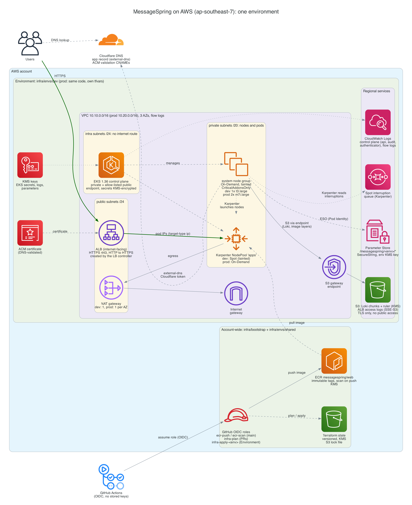
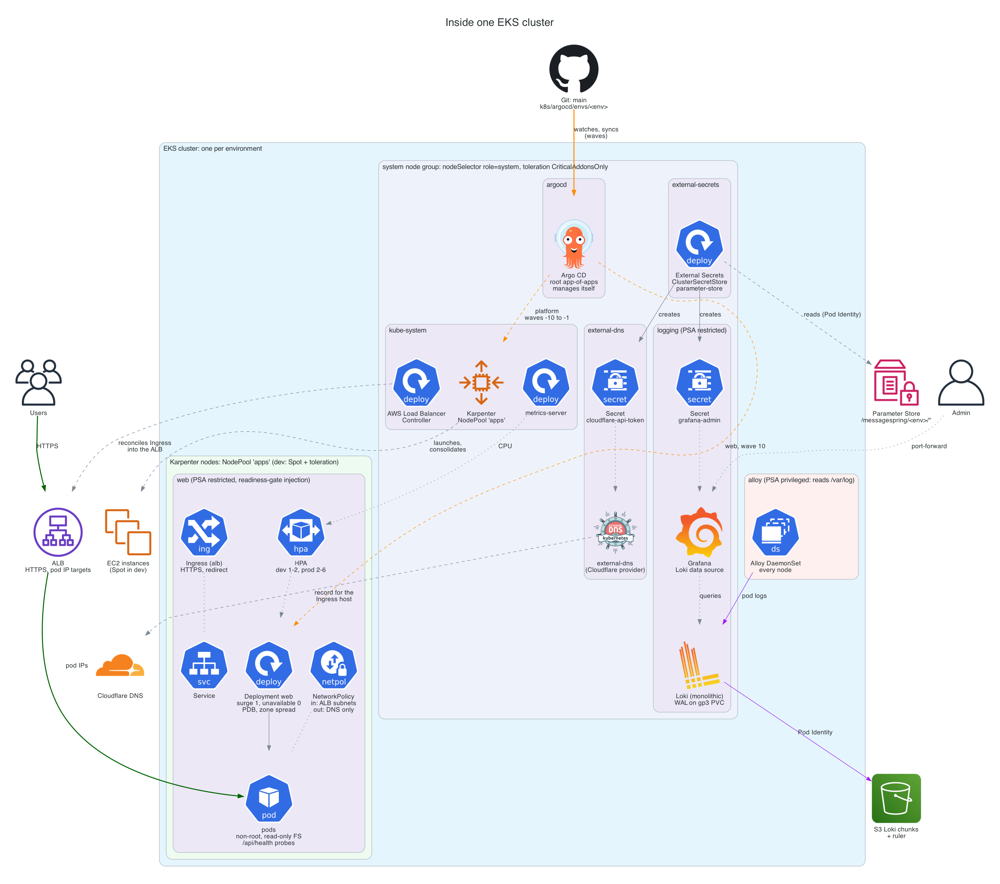

# Architecture diagrams

The diagrams are code: edit the source, run `./render.sh`, and commit the
source and the image together, so the images always match the code they
describe. [ARCHITECTURE.md](../ARCHITECTURE.md) explains the decisions behind them.

## AWS infrastructure ([infrastructure.py](infrastructure.py))

One environment's AWS resources (dev and prod are the same Terraform code with
different `terraform.tfvars`), the account-wide resources, and how users,
GitHub Actions and Cloudflare reach them.



## Inside the cluster ([kubernetes.py](kubernetes.py))

What runs in which namespace and on which nodes (the tainted system node group
or Karpenter's nodes), and how each component reaches AWS and Cloudflare.



## Repository structure ([repository.mmd](repository.mmd))

How the repository is organised, and why each part is where it is. The
human-run layers are orange.



## CI/CD and promotion ([cicd.mmd](cicd.mmd))

From a pull request to production: the required checks, the image build and
scan, the Git commit that deploys dev, the promote pull request that deploys
prod, and the infrastructure pipeline.



## Argo CD sync waves ([gitops.mmd](gitops.mmd))

How Argo CD is bootstrapped, and the order it syncs everything in. Colours mark
the AppProject: grey `root`, blue `platform`, green `apps`.



## Rendering

```bash
architecture/render.sh                 # everything
architecture/render.sh kubernetes      # one diagram
```

It needs Python 3.11+, Graphviz and Node.js 22.13+:

- **`*.py`:** [diagrams](https://diagrams.mingrammer.com/) (Graphviz) → PNG. The packages
  are installed into `architecture/.venv` from `requirements.txt`, where every
  dependency is pinned by hash. To change a version, edit `requirements.in` and
  regenerate the file with the command at its top.
- **`*.mmd`:** [Mermaid CLI](https://github.com/mermaid-js/mermaid-cli) → SVG, run through
  `npx` at the version pinned in `render.sh`.

Rendering is reproducible: running `render.sh` without changing a source gives
identical files, so a diff in an image always means the diagram changed.
